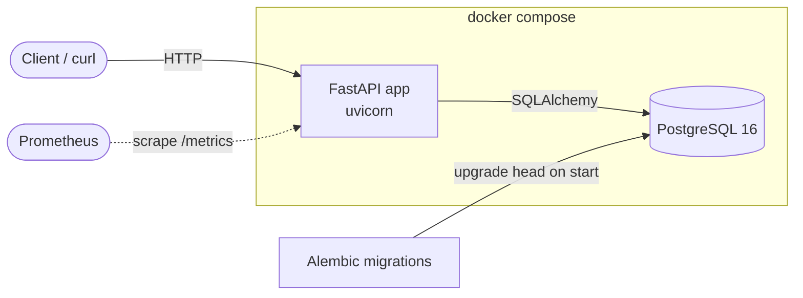

# bakery-orders-api

FastAPI + PostgreSQL order API for a small cottage bakery (Dang Good Pies).
Customers' orders go in, the baker moves them through `pending → baking → ready → picked_up`.

## Architecture



- `app/main.py` – app, `/health`, request-metrics middleware
- `app/routers_orders.py` – order endpoints
- `app/models.py`, `app/schemas.py` – SQLAlchemy models and Pydantic schemas
- `app/metrics.py` – Prometheus `/metrics` (request count, latency)
- `migrations/` – Alembic schema history

## Run it

```bash
cp .env.example .env
docker compose up --build      # API on http://localhost:8000, docs at /docs
```

Without Docker (needs a reachable PostgreSQL, see `DATABASE_URL` in `.env.example`):

```bash
pip install -e ".[dev]"
alembic upgrade head
uvicorn app.main:app --reload
```

## Test and lint

```bash
pytest
ruff check . && ruff format --check .
```

## API examples

```bash
# create an order
curl -X POST localhost:8000/orders -H 'content-type: application/json' -d '{
  "customer_name": "Sam",
  "items": [{"product": "Apple pie", "quantity": 2, "unit_price": "18.50"}]
}'

curl localhost:8000/orders                    # list all
curl 'localhost:8000/orders?status=baking'    # filter by status
curl localhost:8000/orders/1                  # fetch one (404 if missing)

# move it along
curl -X PATCH localhost:8000/orders/1/status \
  -H 'content-type: application/json' -d '{"status": "baking"}'

curl localhost:8000/health
curl localhost:8000/metrics
```

## Database migrations

Schema changes are managed with Alembic. The database URL comes from `DATABASE_URL`.

```bash
alembic upgrade head                                  # apply all migrations
alembic revision --autogenerate -m "describe change"  # after editing app/models.py
```

## CI/CD

GitHub Actions runs ruff, pytest and a Docker build on every push and PR.
Pushing a `v*` tag publishes the image to GHCR. Dependabot keeps pip, Docker
and Actions dependencies current.

See [ROADMAP.md](ROADMAP.md) for the build plan.
